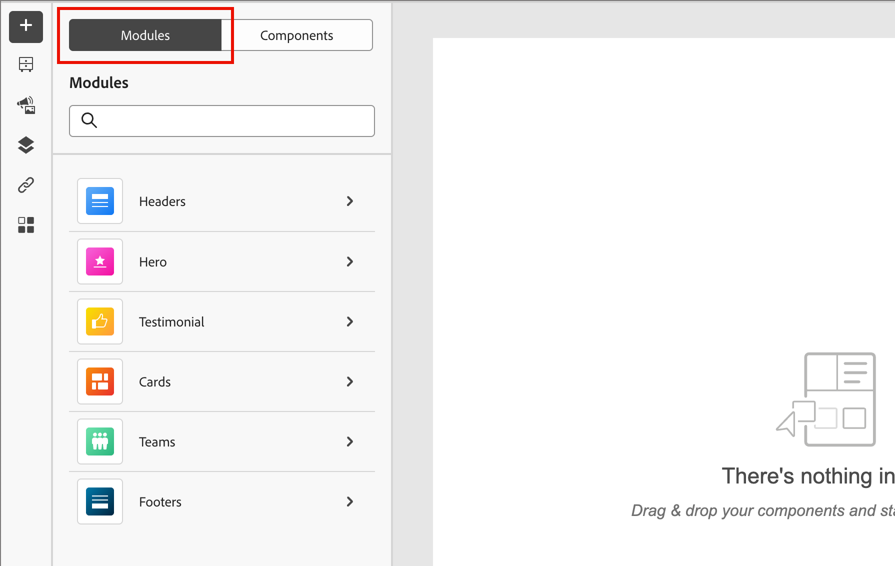

# 內容製作 — 模組

使用[內容模組](../user/content/content-modules.md)，從準備好的區段（例如頁首、橫幅、卡片和頁尾）建置您的設計。 每個模組都包含您可以自訂的結構、樣式和預設內容。

1. 在視覺化設計空間中，選取&#x200B;**[!UICONTROL 模組]**&#x200B;標籤（如果看不到）。

   在視覺化設計空間中顯示的{width="500" zoomable="yes"}

1. 瀏覽類別，或使用搜尋欄位依名稱尋找模組。

   展開類別以檢閱其版面變體。

1. 將模組變體拖曳至畫布上。

   {width="650" zoomable="yes"}

1. Select模組中的元素，以將預設文字、影像和連結取代為您自己的內容。

1. 使用&#x200B;**[!UICONTROL 設定]**&#x200B;和&#x200B;**[!UICONTROL 樣式]**&#x200B;標籤來自訂選取的元件。

   ![已在模組中選取影像元件，且已顯示[設定]及[樣式]索引標籤。](../assets/content-design-shared/content-design-modules-element-settings.png){width="650" zoomable="yes"}

   若要新增更多內容至模組，請選取&#x200B;**[!UICONTROL 元件]**&#x200B;索引標籤，並將內容元件拖曳至模組。