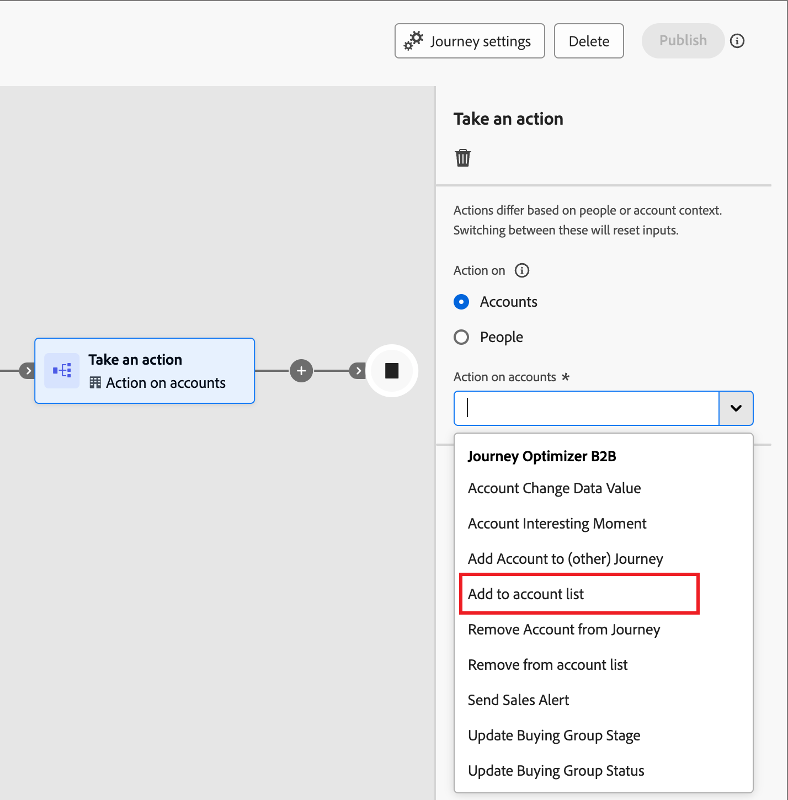
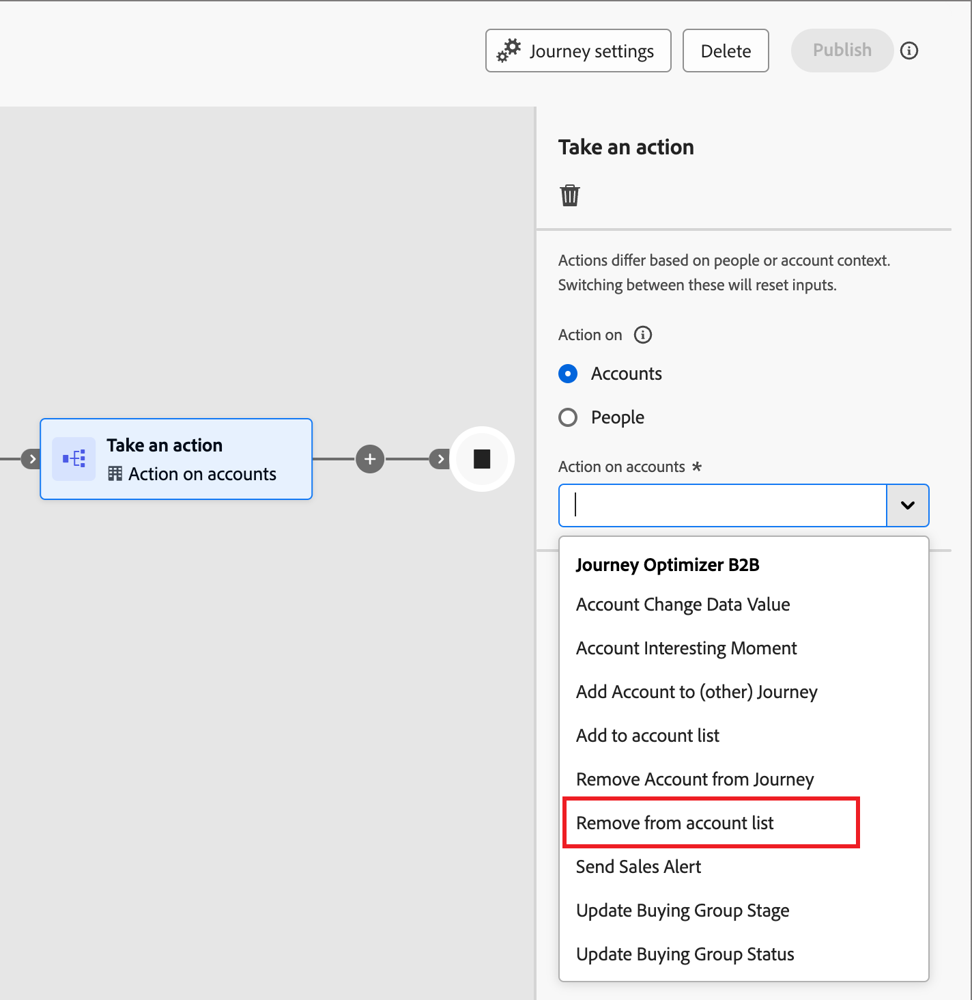

# 在歷程中使用帳戶清單

您有多種方式可以將即時（已發佈）帳戶清單合併到帳戶歷程中。

## 帳戶對象節點

所有帳戶歷程都以&#x200B;[_帳戶對象_&#x200B;節點](../journeys/account-audience-nodes.md)開始。 當您設定此節點使用帳戶清單時，成員帳戶會在歷程上線（發佈）時移動歷程。

1. 針對起始&#x200B;_帳戶對象_&#x200B;節點Select **[!UICONTROL 帳戶清單]**&#x200B;選項。

   帳戶對象節點的{width="500"}

1. 按一下&#x200B;**[!UICONTROL 新增帳戶清單]**。

1. Select帳戶清單的核取方塊，然後按一下&#x200B;**[!UICONTROL 儲存]**。

   帳戶對象節點的{width="600" zoomable="yes"}

## 採取動作節點 — 新增至帳戶

**_僅限靜態帳戶清單_**

在帳戶歷程中，使用[a _執行動作_&#x200B;節點](../journeys/action-nodes.md)將帳戶新增至靜態帳戶清單。

例如，您有一個傳送電子郵件的歷程路徑，而某些帳戶會採取各種動作作為回應。 您將此活動視為歷程中的資格點。 透過資格，您想要將它們新增到帳戶清單，該清單用作另一個歷程的對象，該歷程具有適用於合格帳戶的不同流程。

>[!NOTE]
>
>如果節點執行時帳戶已在清單中，則會忽略動作。

1. 在&#x200B;_&#x200B;**[!UICONTROL 帳戶]**&#x200B;選項上Select_&#x200B;動作。

1. 若為帳戶&#x200B;_上的_&#x200B;動作，請選擇&#x200B;**[!UICONTROL 新增至帳戶清單]**。

   {width="500"}

1. 針對&#x200B;**[!UICONTROL Select即時靜態帳戶清單]**，選擇您要新增帳戶的帳戶清單。

   {width="500"}

## 採取動作節點 — 從帳戶移除

**_僅限靜態帳戶清單_**

在帳戶歷程中，使用[a _執行動作_&#x200B;節點](../journeys/action-nodes.md)從靜態帳戶清單移除帳戶。

例如，您有一個傳送電子郵件的歷程路徑，而某些帳戶會採取各種動作作為回應。 您將此活動視為歷程中的資格點。 有了此資格，您就會想要從帳戶清單中移除他們。 此清單會作為另一個歷程的對象，該歷程會傳送其他電子郵件，讓您不會複製資格通訊。

>[!NOTE]
>
>如果帳戶不在排定移除的清單中，則會忽略動作。

1. 在&#x200B;_&#x200B;**[!UICONTROL 帳戶]**&#x200B;選項上Select_&#x200B;動作。

1. 若為帳戶&#x200B;_上的_&#x200B;動作，請選擇&#x200B;**[!UICONTROL 從帳戶清單移除]**。

   {width="500"}

1. 針對&#x200B;**[!UICONTROL Select即時靜態帳戶清單]**，選擇您要移除帳戶的帳戶清單。

   {width="500"}

## 分割路徑節點 — 帳戶清單的帳戶成員 {#split-paths-account-member-of-account-list}

**_僅限帳戶歷程_**

在依帳戶分割的&#x200B;[_分割路徑_&#x200B;節點](../journeys/split-merge-paths-nodes.md#add-a-split-path-by-account-node)中，使用&#x200B;_[!UICONTROL 帳戶清單的帳戶成員]_&#x200B;篩選器。 帳戶是否為一或多個選取帳戶清單的成員。 若要在清單中包含帳戶，請將成員資格設為`true`，或將其設為`false`以排除這些帳戶。

若要排除封鎖清單上的帳戶，請新增&#x200B;_[!UICONTROL 帳戶清單的帳戶成員]_&#x200B;篩選器，將成員資格設定為`false`，然後選取清單。

1. 導覽至歷程圖。

1. 按一下路徑上的加號( **+** )圖示，然後選擇&#x200B;**[!UICONTROL 分割路徑]**。

1. 在右側的節點屬性中，選擇&#x200B;**[!UICONTROL 帳戶]**&#x200B;進行分割。

1. 若要定義&#x200B;_[!UICONTROL 路徑1]_&#x200B;的條件，請按一下[套用條件]。**&#x200B;**

1. 定義帳戶清單篩選器。

   * 在條件編輯器中，展開&#x200B;_[!UICONTROL 特殊篩選器]_&#x200B;資料夾，並將&#x200B;**[!UICONTROL 帳戶清單的帳戶成員]**&#x200B;篩選器拖曳到條件工作區。

   * 若要在清單中包含帳戶，請將成員資格設為`true`，或將其設為`false`以排除這些帳戶。

   * Select一或多個帳戶清單。

   {width="700" zoomable="yes"}

   您可以將帳戶清單成員資格篩選器與其他帳戶篩選器結合，並選擇符合所有條件或任何條件。 在上方套用&#x200B;**[!UICONTROL 篩選邏輯]**，以精簡條件。

1. 按一下「**[!UICONTROL 完成]**」。

繼續設定分割路徑節點，如[依帳戶節點新增分割路徑](../journeys/split-merge-paths-nodes.md#add-a-split-path-by-account-node)中所述。

## 分割路徑節點 — 帳戶清單的人員成員 {#split-paths-member-of-account-list}

**_個人歷程僅限_**

在人員歷程的&#x200B;[_分割路徑_&#x200B;節點](../journeys/split-merge-paths-nodes.md)中使用帳戶清單成員資格篩選器，以根據人員的帳戶是否為帳戶清單的成員來路由人員。 有兩個篩選器可供使用：

| 篩選 | 說明 |
| ------ | ----------- |
| [!UICONTROL 帳戶動態清單的個人成員] | 此人的帳戶是否為一或多個動態帳戶清單的成員。 |
| [!UICONTROL 帳戶靜態清單的成員] | 此人的帳戶是否為一或多個靜態帳戶清單的成員。 |

若要從Nurture路徑排除已封鎖帳戶中的人員，請新增&#x200B;_[!UICONTROL 帳戶靜態清單的「人員」成員]_&#x200B;篩選器，將運運算元設定為`is not`，然後選取清單。

1. 導覽至歷程圖。

1. 按一下路徑上的加號( **+** )圖示，然後選擇&#x200B;**[!UICONTROL 分割路徑]**。

1. 若要定義&#x200B;_[!UICONTROL 路徑1]_&#x200B;的條件，請按一下[套用條件]。**&#x200B;**

1. 定義帳戶清單篩選器

   * 在條件編輯器中，展開&#x200B;_[!UICONTROL 特殊篩選器]_&#x200B;資料夾，並將&#x200B;**[!UICONTROL 帳戶動態清單的「人員」成員]**&#x200B;或&#x200B;**[!UICONTROL 帳戶靜態清單的「人員」成員]**&#x200B;篩選器拖曳到條件工作區。

   * 若要包含帳戶在清單中的人員，請將運運算元設為`is`，或將其設為`is not`以排除這些人員。

   * Select一或多個帳戶清單。

     {width="700" zoomable="yes"}

   您可以將帳戶清單成員資格篩選器與其他人員篩選器結合，並選擇符合所有條件或任何條件。 在上方套用&#x200B;**[!UICONTROL 篩選邏輯]**，以精簡條件。

1. 按一下「**[!UICONTROL 完成]**」。

繼續設定分割路徑節點，如[依人員新增分割路徑](../journeys/split-merge-paths-nodes.md#add-a-split-path-by-people-node)中所述。
