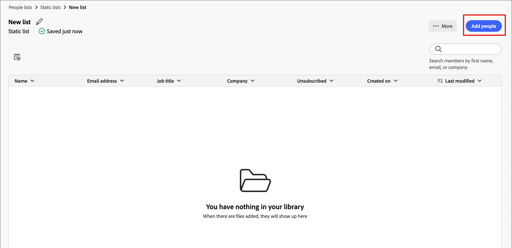

# 靜態人員清單

靜態[人員清單](./people-lists.md)是人員設定檔的集合，其成員資格只有在您新增或移除人員時才會變更。 參考個人屬性和活動的簡單篩選器可定義靜態清單成員資格。 只有在新增或移除成員時，成員資格才會變更。 您可以：

* [套用一次評估過的篩選器集以新增人員](#static-list-add-members)。
* 使用[!UICONTROL 新增至人員清單]和[!UICONTROL 從人員清單移除]動作，透過帳戶或人員歷程新增及移除人員。 （請參閱[在歷程中使用人員清單](./people-lists-journeys.md)）
<!-- * [Activate the list to a destination](#static-list-activate) to sync its membership downstream. -->

>[!NOTE]
>
>新增成員至清單時，會套用一次靜態清單篩選定義。 已定義的篩選器之後將無法使用。 如果要使用篩選器維持一致的對象定義，請改用[動態清單](./people-lists-dynamic.md)。

## 新增成員 {#static-list-add-members}

>[!NOTE]
>
>如果您希望靜態清單一開始是空的，請勿套用篩選器。 當您計畫透過歷程新增成員時，空白的靜態清單會很有用。

1. 開啟靜態清單，然後按一下右上方的&#x200B;**[!UICONTROL 新增人員]**。

   {width="700" zoomable="yes"}

1. 在&#x200B;_[!UICONTROL 新增人員]_&#x200B;對話方塊中，從左側面板拖曳篩選器，以定義用於限定設定檔的規則。

   使用下列任一組合來篩選設定檔：

   * 活動歷史記錄
   * 啟用Experience Platform的人員欄位
   * 自訂欄位
   * 意圖資料
   * 人員屬性
   * 特殊篩選器，例如歷程成員資格

   這些篩選器巢狀內嵌在類別資料夾中。 展開每個資料夾並捲動瀏覽可用的篩選器，或使用頂端的&#x200B;_搜尋_&#x200B;欄位來尋找您需要的篩選器。 對於您新增的每個篩選器：

   * 將篩選器從左側面板拖曳至篩選器定義空間。
   * 完成比對評估定義。
   * 按一下&#x200B;**[!UICONTROL 新增限制]**&#x200B;以精簡符合的條件。

   在上方套用&#x200B;**[!UICONTROL 篩選邏輯]**，微調條件。 您可以選擇符合所有條件、任何條件，或定義進階邏輯。

   {width="800" zoomable="yes"}

1. 按一下&#x200B;**[!UICONTROL 完成]**&#x200B;以儲存變更。

   系統會處理請求，並在新增人員時顯示確認訊息。 處理時間取決於要評估的人數以及您選取的篩選條件。 當清單持續填入時，請使用&#x200B;_[!UICONTROL 更多]_&#x200B;功能表中的&#x200B;**[!UICONTROL 重新整理成員]**&#x200B;來重新整理清單。

   資格成員會在短暫延遲後出現在清單中。 篩選器集只會評估一次，因此之後符合篩選器的人員不會自動新增。 您可以隨時重複此程式，將更多人員新增至清單。

   靜態人員清單的{width="700" zoomable="yes"}

## 移除成員 {#static-list-remove-members}

您可以使用[!UICONTROL 從人員清單移除]動作，透過歷程自動從靜態清單移除人員。 （請參閱[在歷程中使用人員清單](./people-lists-journeys.md)）

<!--
TODO: Restore this section when the activate to a destination function is released.

## Activate to a destination {#static-list-activate}

Activating a static people list sends its membership to a connected destination, with ongoing sync instead of a one-time export. This is useful for paid media targeting, suppression, and downstream orchestration.

* The static list acts as a container for the people.
* The activation sends and syncs that membership to a destination.
* People added to the list later are propagated automatically.
* People removed later are deactivated automatically.

>[!PREREQUISITES]
>
>You must have one or more configured destinations for your [!DNL Journey Optimizer B2B Edition] sandbox before you can activate a static list to a destination. See [Destinations](./destinations.md).

1. Select the **[!UICONTROL Static lists]** tab.

1. Locate the static list that you want to activate, click the _More menu_ ( **...** ) icon next to the list, and choose **[!UICONTROL Activate to destination]**.

   {width="450"}

   You can also open the static list and use the **[!UICONTROL More]** menu at the top right.

1. Select the check box for the configured destination connection.

   {width="600" zoomable="yes"}

1. Click **[!UICONTROL Save]**.

1. In the _[!UICONTROL Activate list to destination]_ dialog, click **[!UICONTROL Activate]** to confirm.

When activation completes, a confirmation message appears and the destination shows as **[!UICONTROL Active]** on the **[!UICONTROL Destinations]** tab of the list. You can activate a static list to more than one destination at a time. Membership syncs to all of them.

To review the destinations that a static list is activated to, open the list and select the **[!UICONTROL Destinations]** tab.

### Deactivate a destination {#deactivate-destination}

Remove a destination connection from a static list when you no longer want its membership synced downstream.

1. Open the static list and select the **[!UICONTROL Destinations]** tab.

1. Use the row action to remove the destination that you want to disconnect.

1. Confirm in the _[!UICONTROL Deactivate destination]_ dialog.

Deactivating removes the destination from the list. The people in the list are also removed from the connected destination audience.

-->
