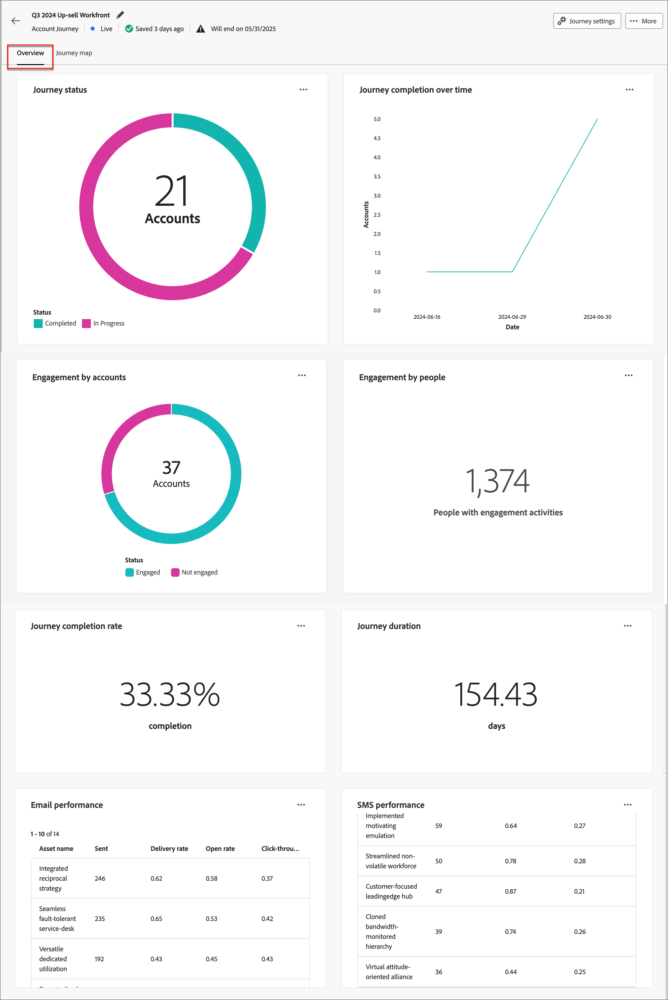
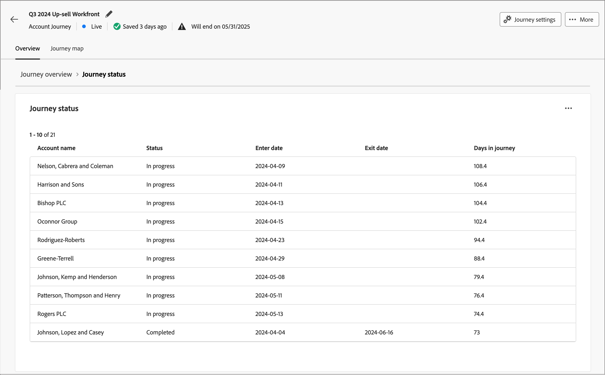
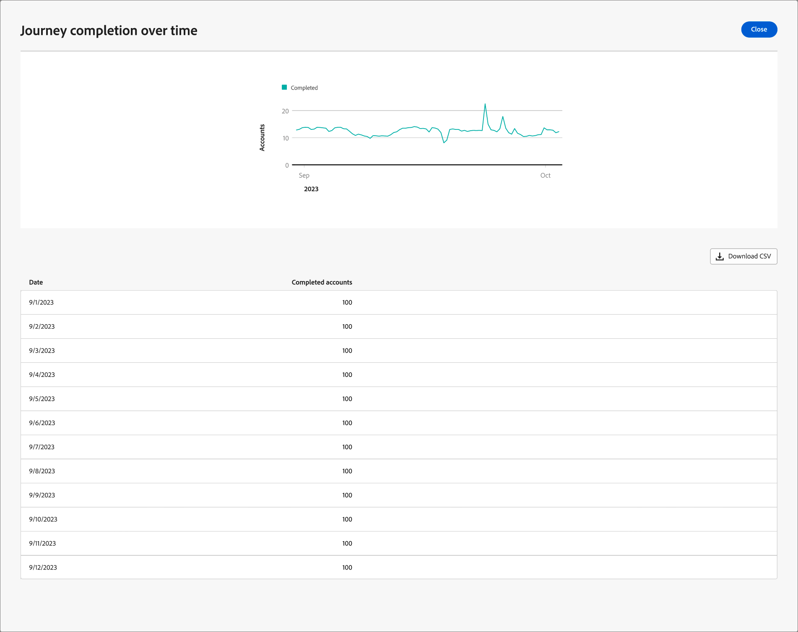
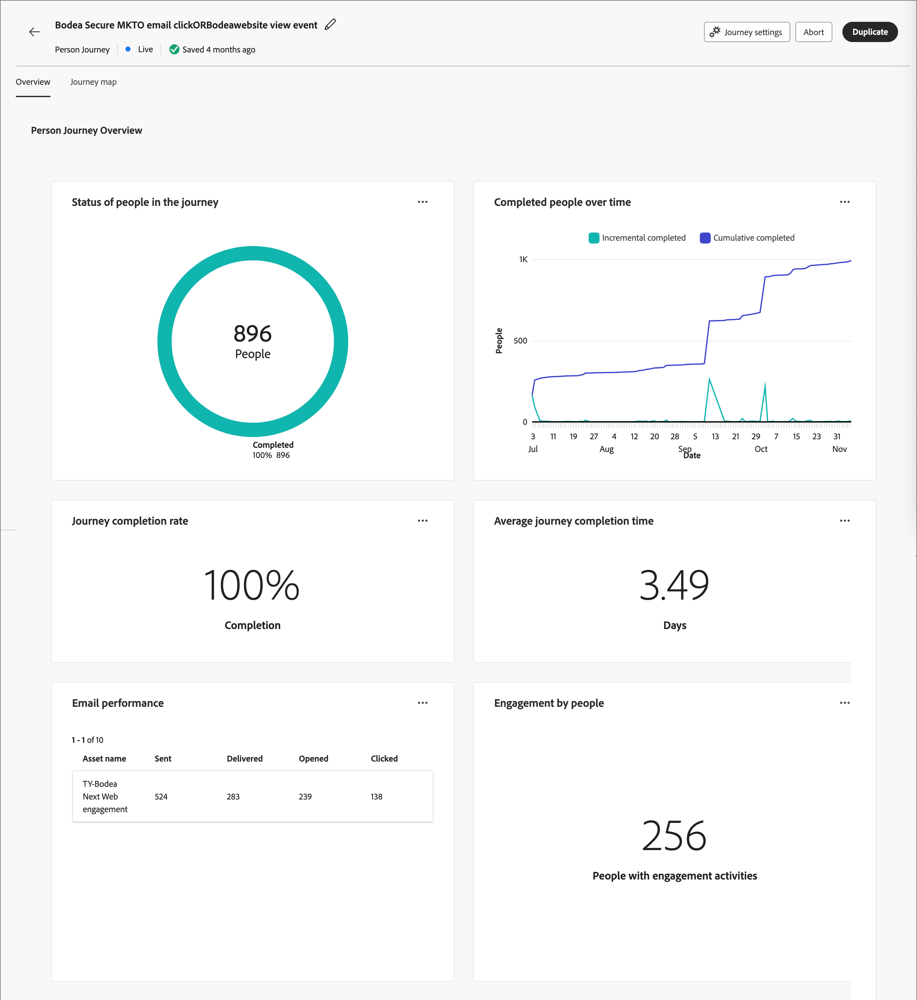

# 歷程詳細資訊

在[!DNL Adobe Journey Optimizer B2B Edition]中，開啟已發佈的帳戶或個人歷程，並選取&#x200B;**[!UICONTROL 概觀]**&#x200B;索引標籤。 檢閱所選歷程的進度、參與和管道效能。

帳戶歷程會報告帳戶的進度。 個人歷程會報告個人的進度。 可用的Widget和量度標籤會因歷程型別而異。 選取控制面板詳細資訊的對應標籤。

若要彙總歷程的電子郵件量度，請使用[電子郵件效能報表](../dashboards/email-performance-dashboard.md)。

>[!BEGINTABS]

>[!TAB 帳戶歷程]

帳戶歷程儀表板會顯示帳戶進度、參與度、管道效能和產生式AI摘要。 資料大約需要四個小時才能開始填入圖表和表格。

{width="700" zoomable="yes"}

## 歷程完成

本節介紹兩個完成量度：

* **[!UICONTROL 歷程中的帳戶狀態]**：顯示帳戶總數和歷程狀態的劃分，包括&#x200B;_已完成_、_進行中_&#x200B;和&#x200B;_已中止_。 每個區段會顯示狀態、百分比及科目計數。
* **[!UICONTROL 一段時間內完成的帳戶]**：顯示一段時間內完成歷程的帳戶數。 水平軸顯示日期，垂直軸顯示帳戶計數。

>[!NOTE]
>
>在帳戶歷程中，歷程&#x200B;]**圖表中的**[!UICONTROL &#x200B;帳戶狀態包含經過歷程的帳戶，即使這些帳戶隨後被刪除。 **[!UICONTROL 鑽研]**&#x200B;會排除已刪除的帳戶，因此它顯示的記錄會比圖表少。 這是預期中的差異。 刪除帳戶不會變更歷史歷程狀態計數。

## 歷程參與

本節介紹兩個參與量度：

* **[!UICONTROL 帳戶參與率]** — 此圓形圖表會將歷程中的帳戶分割為&#x200B;_已參與_&#x200B;和&#x200B;_未參與_&#x200B;類別。 中央圖顯示總計數。 此視覺效果可讓您快速瞭解整體帳戶參與情形。
* **[!UICONTROL 參與者的參與]**：顯示歷程中參與活動的人數。 此值會計入人員，而非參與活動。

## 歷程績效

本節提供兩個重要的量度：

* **[!UICONTROL 歷程完成率]** — 已成功完成其歷程的帳戶百分比。
* **[!UICONTROL 平均歷程完成時間]**：帳戶完成歷程所花費的平均時間（以天為單位）。

## 管道績效 {#email-and-sms-performance}

儀表板包含所選帳戶歷程的&#x200B;**[!UICONTROL 電子郵件效能]**、**[!UICONTROL 簡訊效能]**&#x200B;和&#x200B;**[!UICONTROL WhatsApp效能]**&#x200B;表格。 使用可用的傳送和參與量度來評估每個通訊接觸點。

**[!UICONTROL 電子郵件效能]**&#x200B;資料表資料行：

* _[!UICONTROL 資產名稱]_ — 資產名稱
* _[!UICONTROL 已傳送]_ — 已傳送的電子郵件數目
* _[!UICONTROL 傳遞率]_ — 傳遞的電子郵件數目除以傳送的數目
* _[!UICONTROL 開啟率]_ — 開啟的電子郵件數目除以傳遞的數目
* _[!UICONTROL 點進率]_ — 點按電子郵件數除以傳遞數目

**[!UICONTROL SMS效能]**&#x200B;資料表資料行：

* _[!UICONTROL 資產名稱]_ — 資產名稱
* _[!UICONTROL 已傳送]_ — 已傳送的簡訊數目
* _[!UICONTROL 傳遞率]_ — 傳遞的SMS訊息數除以傳送的訊息數
* _[!UICONTROL 點進率]_ — 點按SMS訊息數除以傳送的號碼
<!--
To generate a shareable PDF of your current view, click **[!UICONTROL Export]** at the top right of the page. 
-->

## 其他動作

使用圖表或資料表的&#x200B;**...**&#x200B;功能表存取其可用的動作。

### 鑽研

對於歷程&#x200B;]**圖表中的**[!UICONTROL &#x200B;帳戶狀態，請選擇&#x200B;**[!UICONTROL 鑽研]**&#x200B;以深入分析個別帳戶狀態。

{width="600" zoomable="yes"}
<!--
The applied global filters are carried over to the view and displayed at the top. Click the _Filter_ icon at the top left to filter the data display by journey.
-->

### 檢視更多

選擇&#x200B;**[!UICONTROL 檢視更多]**&#x200B;以存取延伸資料。 顯示的快顯視窗提供資料的劃分。

{width="600" zoomable="yes"}

若要下載資料，請選取&#x200B;**[!UICONTROL 下載CSV]**。 若要返回&#x200B;_[!UICONTROL 總覽]_&#x200B;儀表板，請選取&#x200B;**[!UICONTROL 關閉]**。

>[!TAB 個人歷程]

人員歷程儀表板會顯示所選歷程中人員的完成、參與和電子郵件效能。

{width="700" zoomable="yes"}

## 歷程完成 {#person-journey-completion}

請使用下列圖表來檢閱歷程中人員的狀態和完成趨勢：

* **[!UICONTROL 歷程中的人員狀態]**：顯示人員總數以及依歷程狀態的劃分。 每個區段都會顯示狀態、百分比和人員計數。
* **[!UICONTROL 一段時間內完成的人數]**：顯示一段時間內完成歷程的人數。 **[!UICONTROL 增量完成]**&#x200B;序列顯示每個時間間隔的完成。 **[!UICONTROL 累計已完成]**&#x200B;序列顯示執行中的完成總數。

>[!NOTE]
>
>在個人歷程中，歷程中&#x200B;]**圖表中的**[!UICONTROL &#x200B;人員狀態包含瀏覽過該歷程的人員，即使他們後來被刪除。 **[!UICONTROL 鑽研]**&#x200B;會排除已刪除的人員，因此它顯示的記錄會比圖表少。 這是預期中的差異。 刪除人員不會變更歷史歷程狀態計數。

對於歷程]圖表中的&#x200B;_[!UICONTROL 人員狀態，請按一下_&#x200B;更多_ ( **...** )圖示，並選取&#x200B;**[!UICONTROL 鑽研]**&#x200B;以檢閱個別人員狀態。

## 歷程參與 {#person-journey-engagement}

**[!UICONTROL 參與者的參與度]** Widget會顯示歷程中具有參與活動的人數。 此值會計入人員，而非參與活動。

## 歷程績效 {#person-journey-performance}

請使用下列測量結果來複查完成效能：

* **[!UICONTROL 歷程完成率]**：完成歷程的人員的百分比。
* **[!UICONTROL 平均歷程完成時間]**：使用者完成歷程所花費的平均時間（以天為單位）。

## 電子郵件績效 {#person-journey-email-performance}

**[!UICONTROL 電子郵件效能]**&#x200B;表格顯示所選人員歷程中每個電子郵件資產的計數，而非費率：

* **[!UICONTROL 資產名稱]**：電子郵件資產的名稱
* **[!UICONTROL 已傳送]**：已傳送的電子郵件數目
* **[!UICONTROL 已傳遞]**：已傳遞的電子郵件數目
* **[!UICONTROL 已開啟]**：已開啟的電子郵件數目
* **[!UICONTROL 已點按]**：已點按的電子郵件數

>[!ENDTABS]
