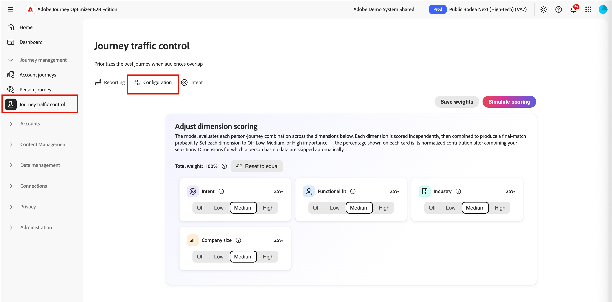
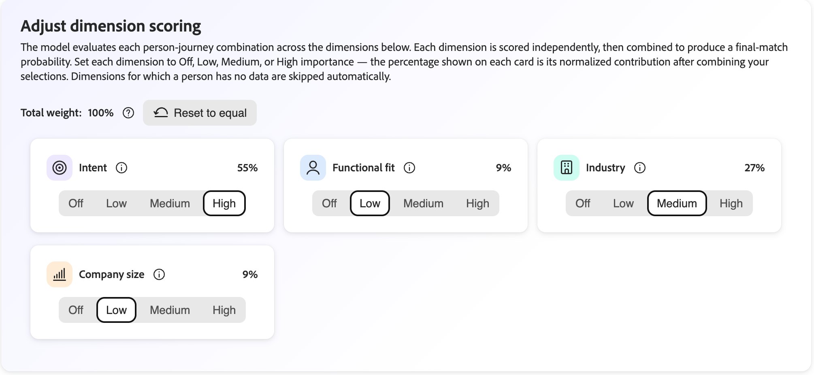
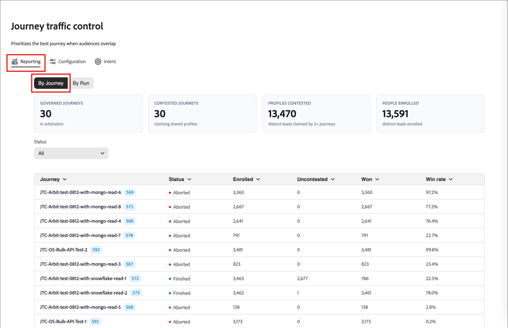

# 歷程流量控制

在[!DNL Adobe Journey Optimizer B2B Edition]中，對象經常重疊。 金融服務公司的行銷總監可以在同一天符合您的產業歷程、產品興趣歷程和企業帳戶歷程的資格。 若無協調，此人會註冊所有這三項作業，並接收競爭或備援訊息。 使用&#x200B;_歷程流量控制_，將符合多個歷程資格的每個人在同一個歷程中註冊時最適合自己。

歷程流量控制會審視每個符合多個參與歷程資格的人。 它會比較您對每個歷程目的所瞭解的個人情況，並註冊最佳相符者。 僅符合一個歷程的人員已註冊該歷程。 符合無資格的人不會註冊。

## 歷程流量控制的優點 {#benefits}

歷程流量控制以每個人的已記錄、符合度型決定取代手動重疊管理。

| 沒有歷程流量控制 | 使用歷程流量控制 |
|---|---|
| 符合多個受眾的人員會註冊數個歷程並接收重疊訊息。 | 每個人在每個評估中最多只能註冊一個參與歷程。 |
| 團隊會透過排除區段和受眾規則手動管理重疊。 隨著每個新歷程的進行，這些規則更難維護。 | 系統會根據配合進行選擇。 您沒有建立或維持排除邏輯。 |
| 很難解釋為什麼個人會收到特定歷程。 | 每個決定都會記錄並可供檢視，包括每個競爭歷程的分數。 |
| 訊息疲勞和混合式傳訊會減少參與度。 | 每個人都會獲得一個相關、一致的體驗。 |

## 使用範例 {#examples}

當您的歷程鎖定重疊的對象時，請使用歷程流量控制。 例如：

* **產業培養計畫**：您針對金融服務、醫療保健和製造分別執行歷程。 連絡人沒有產業價值，但其設定檔已連結至銀行的帳戶。 歷程流量控制會將聯絡人配對Financial Services歷程，而非將他們全部註冊。
* **產品興趣行銷活動**：您針對每個產品線執行一個歷程。 具有兩個產品中最近興趣訊號的潛在客戶在歷程中註冊了具有最強烈興趣的產品。
* **角色型訊息**：您執行一個技術評估員的歷程，另一個為主管贊助者的歷程。 個人的職稱和職能決定他們加入哪個歷程。
* **企業與SMB程式**：您依公司規模執行不同的歷程。 連絡人的客戶區段和帳戶資訊會決定他們加入哪個歷程。
* **新歷程啟動**：您將新歷程發佈至其他歷程已涵蓋的對象。 歷程流量控制會評估重疊，因此您不會重新設計現有的受眾規則。

## 依符合度選取 {#dimensions}

當個人符合多個歷程的資格時，歷程流量控制會將個人的設定檔與每個候選歷程的名稱和說明進行比較。 比較範圍涵蓋四個維度。

| 維度 | 比較內容 |
|---|---|
| 行業 | 個人的產業。 如果產業缺失，則連結帳戶的產業。 |
| 功能符合 | 個人的角色和工作職能。 |
| 公司規模 | 人員的客戶區段、科目型態及支出內容。 |
| 意圖 | 個人最近最感興趣的產品。 |

請記住下列幾點：

* **歷程名稱和說明很重要。** 他們會告訴系統每個歷程的目的。 具體、準確的說明會產生更好的相符專案。
* **已略過缺少的資料，並未進行猜測。** 如果人員沒有維度值，歷程流量控制會為該人員保留該維度。 這會針對含有資料的維度做出決定。

報告檢視中每個人的決定記錄會顯示每個競爭歷程的分數和使用的維度。 沒有資料的維度會標示為已排除。

### 比較 {#comparisons}

對於每個維度，歷程流量控制會比較個人的相關文字（例如職稱）與每個歷程的說明。 它使用兩種方法：

* **表示相似性**：文字的意義是否與說明接近？
* **關鍵字元合**：文字是否使用與說明相同的辭彙？

這兩種方法的較強結果會成為該維度的歷程分數。

然後，每個維度會建議其最佳評分歷程，但前提是分數清除最低品質臨界值。 沒有合格提案的歷程會被捨棄。 您設定的權重會根據其合併的加權分數來排名其餘歷程。 已選取分數最高的歷程。 獲勝者不一定是擁有最多提案的歷程。 單一維度上的一個強比對比數個弱比對更重要。

每個決定記錄儲存以下資訊：

* 所選歷程和競爭歷程
* 每個維度的分數和合併分數
* 信賴值
* 協定層級為「高」、「Medium」或「低」，可顯示多少維度支援獲勝者

<!-- CONFIRM with Engineering: whether to describe the fallback when no dimension produces a qualifying match. The source says the person is still enrolled in one eligible journey, selected consistently, with a 0% (Low) confidence decision record. Also confirm how "consistent" should be phrased. -->

## 設定 {#configuration}

若要設定歷程流量控制維度權重並模擬評分：

1. 在左側導覽列上，前往&#x200B;**[!UICONTROL 歷程管理]** > **[!UICONTROL 歷程流量控制]**。

1. 選取&#x200B;**[!UICONTROL 組態]**&#x200B;索引標籤。

{width="800" zoomable="yes"}

### 調整維度權重 {#weights}

依預設，所有四個維度的權重均為&#x200B;_Medium_，且貢獻率相等，均為25%。 調整權重以變更每個維度影響決定的程度。

1. 針對每個維度，設定加權等級：

   * **[!UICONTROL 關閉]**
   * **[!UICONTROL 低]**
   * **[!UICONTROL Medium]**
   * **[!UICONTROL 高]**

   每張卡片上的百分比會顯示您的設定合併後該維度的比例。 若要從決定中移除維度，請將其設定為&#x200B;**[!UICONTROL 關閉]**。

   {width="600"}

   每張卡片上顯示的百分比，是您在結合所有選取範圍後該維度的標準化貢獻，一律為100%。 如果您提高一個尺寸，系統會自動將其他尺寸重新標準化，使總計保持在100%。

   您可以按一下「**[!UICONTROL 重設為等於]**」，將所有維度恢復為均勻加權。

1. 如果要套用調整後的權重，請選取&#x200B;**[!UICONTROL 儲存權重]**。

   >[!NOTE]
   >
   >若要儲存維度權重的變更，您必須擁有&#x200B;_[!UICONTROL 管理B2B管理設定]_ [產品許可權](../admin/user-management.md#b2b-product-permissions)。

### 模擬評分 {#simulate-scoring}

在將權重提交到生產環境之前，您可以模擬流量控制在這些變更中的行為。 模擬不需要啟用歷程流量控制。 它會評估您即時歷程中的設定檔，並將流量控制邏輯套用至設定檔。 然後，您可以判斷結果是否適合權重設定。

按一下&#x200B;**[!UICONTROL 模擬評分]**。

結果標題會摘要說明執行：

* **已評估的設定檔** — 已評分的設定檔數，以及歷程數。
* **平均衝突/設定檔** — 每個設定檔的競爭歷程平均數量。
* **平均符合分數** — 所選歷程的平均信賴度。

{width="700" zoomable="yes"}

每個評估的設定檔都會顯示為卡片，顯示選取的歷程、關鍵理由、意圖訊號及比對分數。 選取要開啟詳細資料檢視的設定檔：

* **相符分數** — 整體相符專案，並依維度以色彩標示劃分。
* **依據歷程的分數** — 此人員符合資格的歷程、選取的歷程及原因。
* **考慮的維度** — 推動決策的維度資料，可展開以顯示基礎訊號。

{width="450" zoomable="yes"}

如有需要，請調整維度權重，然後按一下&#x200B;**[!UICONTROL 再次執行]**&#x200B;以重新執行模擬。

您也可以按一下&#x200B;**[!UICONTROL 新人員範例]**，使用新的隨機範例重新執行模擬。

當您對結果滿意時，可以按一下&#x200B;**[!UICONTROL 儲存權重]**&#x200B;認可權重。 新的流量控制決定會立即使用新設定，但過去的決定不會受到影響。 您測試的權重會顯示在主要&#x200B;_[!UICONTROL 組態]_&#x200B;標籤上，並用於您的即時環境中評估的任何歷程流量控制。

您也可以離開頁面而不套用權數。

## 檢閱報告 {#reporting}

使用報告檢視來檢視歷程流量控制如何註冊人員。 依歷程或執行檢閱決定。

### 依歷程報告 {#reporting-by-journey}

**[!UICONTROL By Journey]**&#x200B;檢視會總結流量控制下的歷程。

| 量度 | 說明 |
|---|---|
| 已控管的歷程 | 參與流量控制的歷程。 |
| 有爭議的歷程 | 至少與其他一個歷程共用人員的歷程。 |
| 有爭議的設定檔 | 兩個或更多歷程宣告的不同人員。 |
| 已註冊的人員 | 已註冊的不同人員。 |

對於每個歷程，檢視也會顯示下列值：

* **[!UICONTROL 已註冊]**：已註冊的總人數。
* **[!UICONTROL 無爭議]**：僅符合此歷程的人。
* **[!UICONTROL 贏]**：符合數個歷程資格且已註冊此歷程的人員。
* **[!UICONTROL 獲勝率]**：人們競爭時歷程獲勝的頻率。

{width="700" zoomable="yes"}

依[歷程狀態](./journeys-overview.md#journey-status)篩選清單： [!UICONTROL 即時]、[!UICONTROL 已完成]、[!UICONTROL 已中止]或[!UICONTROL 全部]。

若要檢視歷程中爭議人群的結局，請開啟歷程。 詳細資料檢視會顯示使用者已改為註冊的歷程。 若要檢視相符分數、競爭歷程、每個人的分數以及使用的維度，請展開任何已註冊人員的決定記錄。 依名稱、銷售機會ID或設定檔ID搜尋。

{width="700" zoomable="yes"}

若要比較產業或意圖產品在歷程中的分配情形，請選取&#x200B;**[!UICONTROL 比較歷程]**，並選擇至少兩個及最多20個即時歷程。

<!-- Figure placeholders: By Journey overview, journey detail "Where contested profiles landed", and a decision record. Redact person names and use clean sample journey names without test prefixes. Choose runs with healthy enrollment counts. -->

### 按執行報告 {#reporting-by-run}

選取&#x200B;**[!UICONTROL 由執行]**&#x200B;以檢視每個評估回合的清單，其中包含下列資訊：

* 執行時間
* 觸發執行的方式： *已排程*、*發佈*，或&#x200B;*手動*
* 評估、註冊及未註冊的人數

{width="700" zoomable="yes"}

依時間範圍（24小時、7天、30天或所有時間）和觸發型別篩選清單。

若要檢視從受評估人員到他們已註冊歷程的流程圖，請開啟回合。 每個歷程的劃分會顯示有多少人&#x200B;**[!UICONTROL 未註冊]**、**[!UICONTROL 已註冊]**、**[!UICONTROL 已仲裁]** （選擇於競爭歷程中）及&#x200B;**[!UICONTROL 無爭議]**。 對於回合中的任何歷程，您也可以檢視評估的人員、其結果、其競爭的歷程及其匹配分數。

{width="500" zoomable="yes"}

<!-- CONFIRM with Product: what the scheduled and on-publish triggers mean for customers, and the content of the Not enrolled tooltip. -->

## 評估執行程式 {#run-process}

每次執行都遵循相同的順序。 歷程流量控制只會讀取您[!DNL Journey Optimizer B2B Edition]環境中已存在的資料，不需要其他資料來源。

1. 歷程流量控制會等待環境中的人員和帳戶[設定檔重新整理](../data/data-availability-timing.md#daily-refresh)成功完成。 如果重新整理失敗，過時資料不會開始執行。

1. 在[!DNL Adobe Experience Platform]中計算對象會籍，並將[同步化](../data/data-availability-timing.md#platform-sync)至[!DNL Journey Optimizer B2B Edition]。 區段完成後，系統會等待同步處理完成，最長為30分鐘。 如果同步化更早完成，處理就會立即開始。 如果先經過30分鐘，仍會開始處理。 如果同步稍後完成，則會在更新的資料上開始新的執行。

1. 系統會組合候選歷程。 只有已上線並啟用流量控制的歷程才會參與。 系統會讀取每個歷程的狀態、名稱和說明。

1. 系統會以小批次讀取對象成員資格和設定檔內容。

1. 系統會檢查資格。 只有當以下所有條件都成立時，個人才符合歷程的資格：

   * 歷程為即時狀態並啟用流量控制。
   * 此人目前是歷程對象的成員。
   * 此人之前未成功註冊該歷程。
   * 此人目前未註冊該歷程。

1. 系統會選取歷程。 有一個合格歷程的人員已註冊該歷程。 沒有合格歷程的人未註冊。 對於具有數個合格歷程的人，系統會比較該人的設定檔與跨[四個維度](#dimensions)的每個歷程名稱和說明。

1. 系統會透過標準歷程註冊機制，將註冊提交至所選歷程。

1. 系統會儲存每個決定和註冊結果以用於報告和稽核。

1. 系統會在批次完成時檢查進度、記錄結果，並傳送完成通知。

## 使用和儲存的資料 {#data}

歷程流量控制會使用以下您環境中的資料。

| 資料 | 來源 | 使用 |
|---|---|---|
| 歷程狀態、名稱和說明 | 您的歷程 | 決定要參與哪些歷程以及每個歷程的目的。 |
| 客群會籍 | [!DNL Experience Platform]個對象已同步處理至[!DNL Journey Optimizer B2B Edition] | 識別符合每個歷程的人員。 |
| 個人設定檔，例如，產業、職稱和職能，以及客戶區段 | 您的個人資料 | 提供產業、功能配合及公司規模等維度。 |
| 連結的帳戶設定檔，例如，產業和帳戶型別 | 您的帳戶資料 | 當個人自己的值遺失時，填寫產業並提供帳戶內容。 |
| 產品興趣 | 您的[意圖資料](../admin/intent-data.md) | 提供意圖維度。 使用興趣最強烈、最新的產品。 |
| 註冊記錄 | 先前執行寫入的記錄 | 避免在同一歷程中重複註冊相同人員。 |
| 目前的註冊狀態 | [!DNL Journey Optimizer B2B Edition] | 避免註冊已在歷程中的人員。 |

每次執行，歷程流量控制都會儲存執行摘要。 對於每個已註冊的人員，都會儲存註冊決定記錄。 兩者都會儲存在您環境的Adobe管理資料存放區中。 這些功能可加強報表功能並防止重複註冊。

<!-- 
CONFIRM with Engineering, Security, and Legal before publishing. The source material does not state any of the following data handling commitments:
- Where processing occurs and data residency.
- Whether meaning similarity comparison uses a third-party or externally hosted AI service, and whether profile text leaves the Adobe environment.
- Whether customer data is used to train models shared with other customers.
- The retention period for decision and enrollment records, and how they are deleted when a person is erased (link to privacy requests).
- Encryption in transit and at rest, role-based access to the reports, and tenant isolation. 
-->

## 設定歷程流量控制 {#setup}

您可以在個人[個人歷程](./create-publish-journey.md)處於&#x200B;_草稿_&#x200B;狀態時，直接對其啟用歷程流量控制。

1. 確定人員歷程的名稱和說明已為歷程提供明確的目的和目標。

   這些名稱和說明是相符的基礎。

1. 按一下&#x200B;**[!UICONTROL ...在歷程畫布的右上角顯示更多]**，然後選擇&#x200B;**[!UICONTROL 歷程流量控制設定]**。

   {width="400"}

1. 在對話方塊中，啟用&#x200B;**[!UICONTROL 啟用歷程流量控制]**&#x200B;選項。

   此設定對話方塊會說明行為：啟用時，歷程會變成候選人，而模型會評估最適合的歷程，並建議符合多個作用中歷程資格的人員。

   ![歷程流量控制設定對話方塊，其開啟了[啟用歷程流量控制]，加上[取消]和[儲存]按鈕](./assets/journey-traffic-control-enable-dialog.png){width="450"}

   >[!IMPORTANT]
   >
   >當歷程保持在&#x200B;_草稿_&#x200B;狀態時，可隨時變更切換。 在您發佈已啟用歷程流量控制的歷程後，歷程會評估進入該歷程的專案，且您無法再停用設定。

1. 按一下&#x200B;**[!UICONTROL 儲存]**。

1. [發佈](./create-publish-journey.md#publish-a-journey)個人歷程。

## 限制和相依性 {#limitations}

下列相依性會影響歷程流量控制何時及如何運作：

* **對象同步**：決定需要從[!DNL Experience Platform]同步到[!DNL Journey Optimizer B2B Edition]的最新對象會籍。 執行時間會在分段和同步完成之後進行。 這不是固定的排程。
* **設定檔重新整理**：只有在人員和帳戶設定檔重新整理成功後，才會開始執行。
* **歷程中繼資料**：只有為流量控制啟用的即時歷程才會參與。 相符的品質取決於您撰寫的名稱和說明。
* **設定檔完整性**：品質取決於您維護的人員、帳戶和意圖資料。 略過缺少的維度。

歷程流量控制有下列限制：

* **每個人員一個歷程**：每個人員最多為每個回合註冊一個歷程。
* **選取範圍無法保證註冊**：在從[!DNL Experience Platform]同步處理完成之前，可能會評估部分設定檔，但不會有相符的Marketo人員ID。 已選取歷程，但註冊可能不成功。 這些人員在執行報表中會顯示為&#x200B;*未註冊*。
* **無重複註冊**：歷程流量控制不會將人員註冊到先前已註冊的歷程中。 若要讓人員重新取得歷程資格，請使用[歷程重新進入設定](./journey-re-entry.md)。
* **非即時**：決策是在執行時做出的，而不是在設定檔變更時做出的。
* **四個固定維度**：您可以調整產業、功能配合、公司規模及意圖的重要性，但無法新增維度。
* **文字型比對**：歷程名稱和說明會與設定檔文字做比較。 含糊不清、空白或類似描述的歷程更難區分。 差異弱的歷程會產生低信賴度的結果。

歷程流量控制僅決定人員註冊的合格歷程。 這不會變更您的歷程或對象。

<!-- CONFIRM with Product and Engineering: the maximum number of governed journeys, maximum audience size for each run, supported editions and regions, and any language limitations for text matching. -->
